# Animação em Ambientes Virtuais — Ninja Adventure: The Skeletons' Curse

Projeto desenvolvido na unidade curricular **Animação em Ambientes Virtuais** (AAV) de LEIM, no **ISEL**, ano letivo [20XX/XX].

**Ninja Adventure: The Skeletons' Curse** é um **jogo 3D em Unity (C#)**, em terceira pessoa, onde um ninja explora uma vila, interage com NPCs, obtém uma espada e enfrenta esqueletos para quebrar a maldição.

- **Aluno:** Fábio Pestana — 50756
- **Aluno:** [Nome] — [Número]
- **Docente responsável:** [Nome do docente]

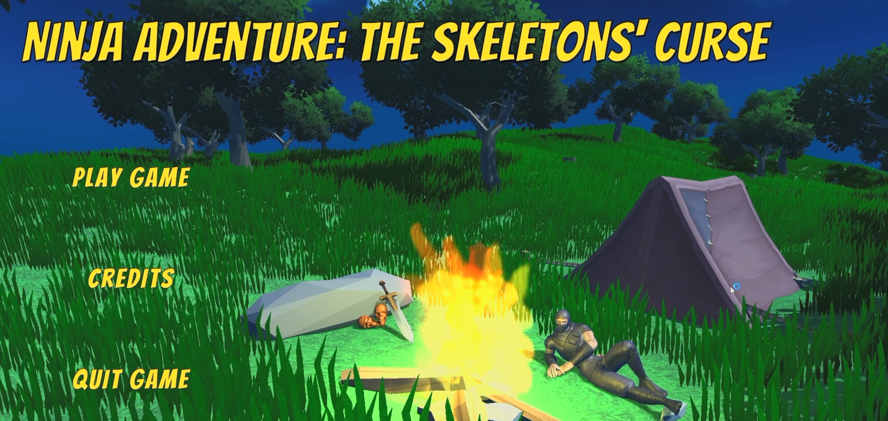

---

## Descrição

O jogador começa numa **vila**, onde pode:

- **Apanhar moedas** em sacos de dinheiro espalhados pelo cenário (tecla `E`)
- **Falar com NPCs**, com diálogos apresentados numa caixa de texto
- **Comprar curas** ao vendedor, por 25 moedas cada

Ao sair da vila, o jogador encontra uma **espada** presa nas rochas, que lhe permite combater. O mapa inclui um **rio**, que o jogador consegue **atravessar a nadar**, e zonas de **fogo** que causam dano.

### Objetivo e condições de jogo

- **Quest:** eliminar os **6 esqueletos** do mapa
- **Vitória:** quando todos os inimigos são eliminados, o jogador guarda a espada e aparece o menu final
- **Derrota:** quando a vida chega a 0, o jogador morre e, após 4 s, aparece o menu de retry

---

## O jogo

### A vila

A aventura começa dentro da vila, cercada por uma paliçada, com casas, um moinho e várias personagens.

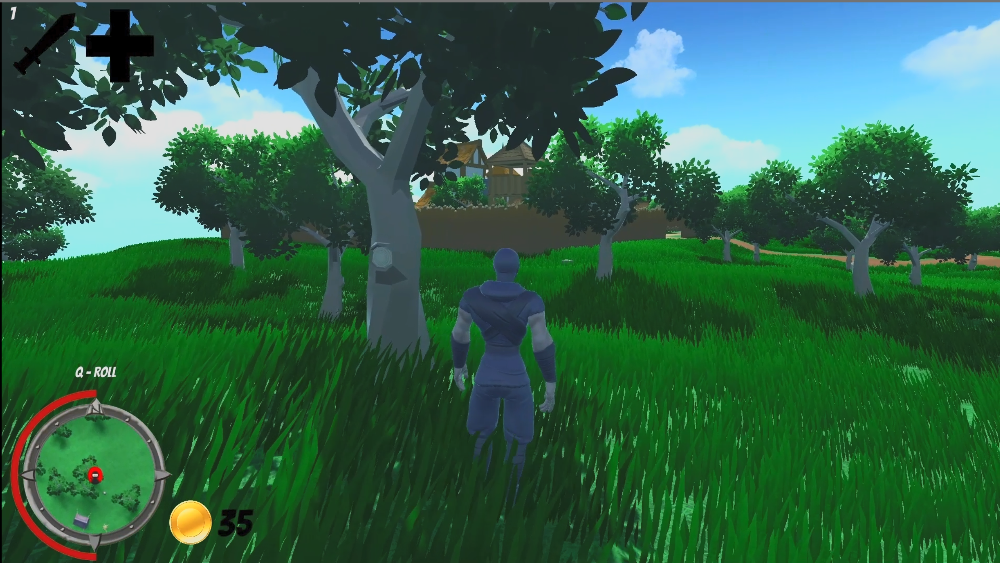

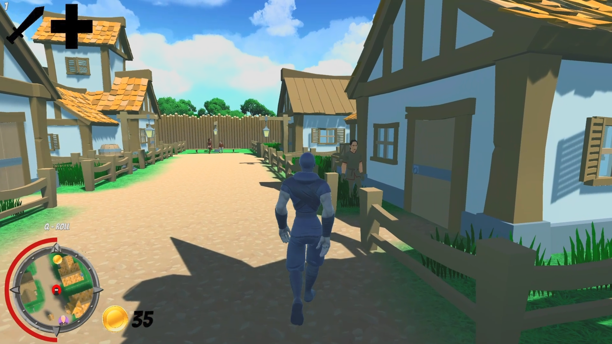

### Loja e NPCs

O vendedor cumprimenta o jogador quando este se aproxima e permite comprar curas. Os restantes NPCs, como o padre Leofric, têm diálogos com efeito de máquina de escrever.

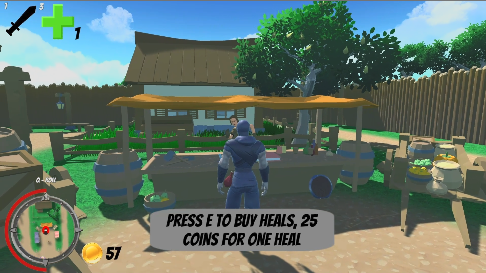

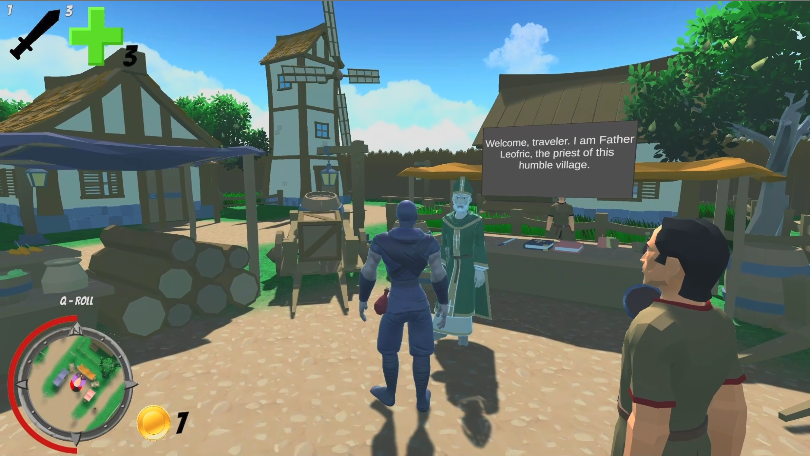

### Fora da vila

Os caminhos fora da vila levam ao local sagrado, onde está a espada presa numa pedra, rodeada por pedras com runas e fogueiras.

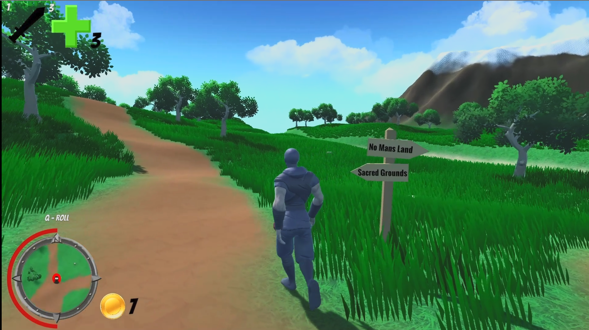

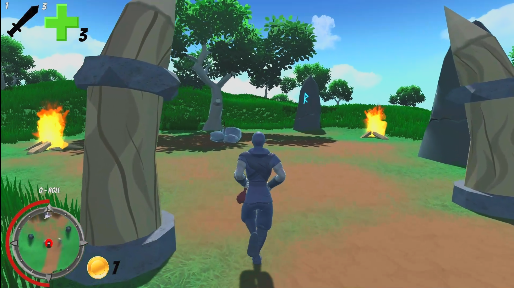

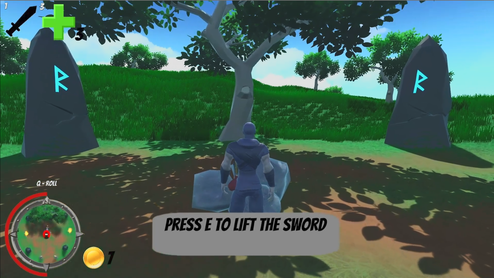

### Rio

Depois de obter a espada, o jogador pode explorar o resto do mapa. O rio pode ser atravessado a nadar, e a espada é guardada automaticamente ao entrar na água.

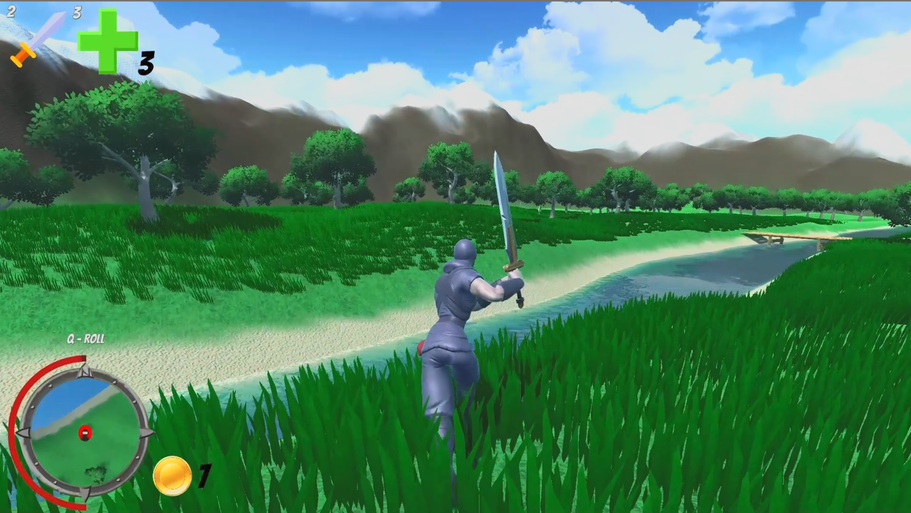

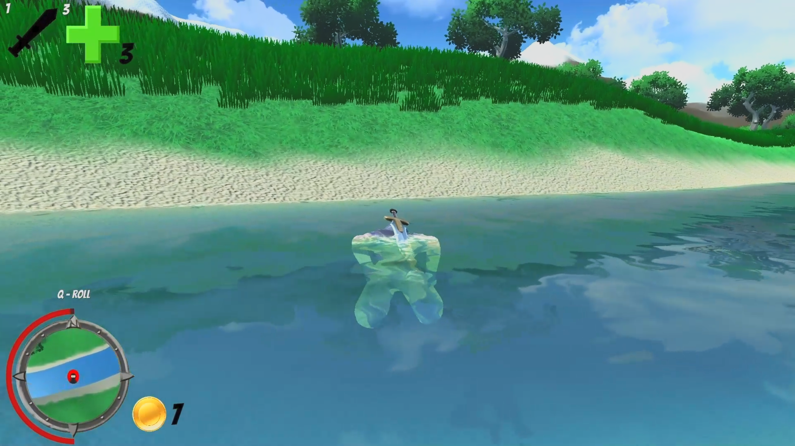

### Combate

Os esqueletos patrulham o mapa, perseguem o jogador quando o veem e têm uma barra de vida visível quando este está perto.

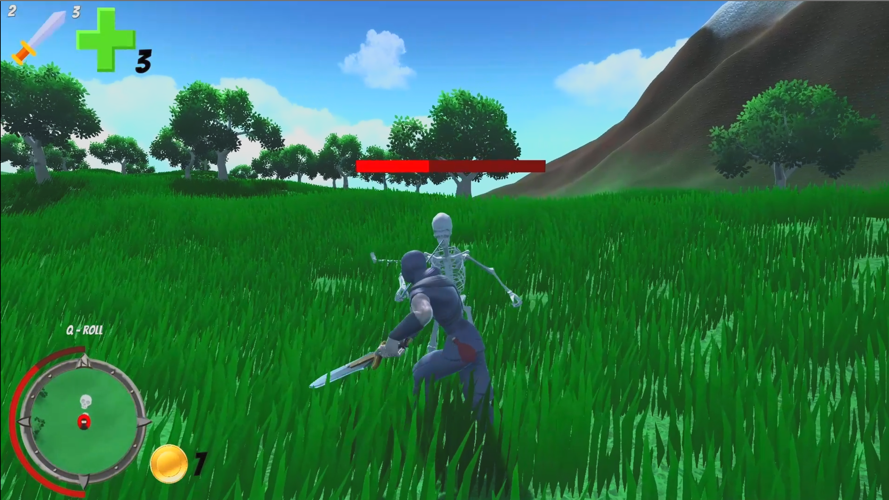

---

## Controlos

| Ação                         | Controlo                               |
|------------------------------|----------------------------------------|
| Mover                        | `W` `A` `S` `D`                        |
| Correr                       | `Shift`                                |
| Rodar câmara / personagem    | Rato                                   |
| Interagir (moedas, loja, espada, NPCs) | `E`                          |
| Tirar a espada               | `1`                                    |
| Guardar a espada             | `2`                                    |
| Preparar cura                | `3` (usa-se com o botão esquerdo do rato) |
| Atacar                       | Botão esquerdo do rato                 |
| Defender                     | Botão direito do rato (manter)         |
| Rolar                        | `Q`                                    |
| Pausa                        | `Esc`                                  |

---

## Jogador

- **Movimento** controlado por *blend trees* no Animator (parâmetros `X` e `Y`), com rotação pelo rato através do `Rigidbody`
- **Espada:** tirar, guardar, atacar e defender, com sons aleatórios de ataque e de choque entre espadas. A espada é guardada automaticamente ao aproximar-se do rio
- **Defesa:** ao defender, o dano dos esqueletos é anulado
- **Roll:** esquiva com ajuste dinâmico da altura e do centro do `CapsuleCollider`
- **Natação:** animação e sons próprios (movimento e parado) ao entrar no rio
- **Curas:** compradas na loja e consumidas com animação, garrafa na mão, partículas e som; recuperam 20 de vida
- **Fogo:** causa dano periódico enquanto o jogador permanece na zona
- **Eventos de animação:** métodos chamados por *Animation Events* (`DrawSword`, `AttackSword`, `PutSword`, `Heal`, sons de passos, etc.)

---

## Interface

- **HUD:** barra de vida em arco à volta do **minimapa**, com transição suave (*easing*), contador de moedas, número de curas, ícones da espada e das curas com a respetiva tecla e lembrete `Q - ROLL`
- **Mensagens de interação** contextuais (apanhar dinheiro, comprar curas, sem dinheiro, levantar a espada)
- **Menus:** menu principal (jogar, créditos, sair), pausa, opções (**volume** e **sensibilidade do rato**), retry e fim de jogo
- **Câmara** de terceira pessoa que segue o jogador com suavização (`LerpAngle`)

---

## Inteligência artificial

### Esqueletos (inimigos)

Os esqueletos são controlados por uma **máquina de estados** (Animator) combinada com **NavMesh**:

| Estado   | Comportamento                                                                 |
|----------|-------------------------------------------------------------------------------|
| `Walk`   | Patrulha, deslocando-se para pontos aleatórios dentro de uma área definida     |
| `Chase`  | Persegue o jogador, atualizando o destino a cada frame                         |
| `Attack` | Roda suavemente (`Slerp`) para ficar virado para o jogador e ataca             |
| `Search` | Para e procura o jogador quando este lhe escapa (por exemplo, ao atravessar o rio) |

Outros detalhes:

- **Perceção:** deteção do jogador por `SphereCast` na direção em que o esqueleto está virado, repetida a cada 0.2 s numa *coroutine*
- **Vida:** cada esqueleto nasce com vida aleatória entre um mínimo e um máximo, com **barra de vida** (`Slider`) que só aparece quando o jogador está a menos de 15 m
- **Dano:** a espada do jogador retira vida ao ser detetada pelo *trigger* do esqueleto (não há dano se o jogador estiver a defender); o dano ao jogador é aleatório
- **Rio:** o *trigger* da água interrompe a perseguição e leva o esqueleto ao estado de procura
- **Morte:** animação de morte, remoção do *collider* e destruição do objeto ao fim de 5 s, contando para a quest do jogador
- **Barra de vida:** orientada sempre para a câmara (`EnemyHealth`)

### NPCs

- **Patrulha** por *waypoints* com `NavMeshAgent`, alternando entre os estados `IdleNpc` e `WalkNpc`
- **Reação ao jogador:** o NPC roda para o jogador quando este se aproxima
- **Diálogos:** painel de texto com efeito de **máquina de escrever**; o clique do rato avança para a linha seguinte ou completa a linha atual
- **Zona de conversa:** o diálogo é iniciado ao entrar num *trigger* (`NPCtalk`) ou ao premir `E` junto do NPC, que pára de andar enquanto fala
- **Vendedor** (`SellerScript`): vira-se para o jogador e cumprimenta-o com uma animação
- **Sons de passos** (`StepsNPC`): clipes de áudio escolhidos aleatoriamente, sincronizados com a animação

---

## Scripts principais

| Script                 | Função                                                              |
|------------------------|---------------------------------------------------------------------|
| `playerScript.cs`      | Jogador (`Player3P`): movimento, combate, curas, dinheiro e loja    |
| `RollScript.cs`        | Estado de roll: ajusta o `CapsuleCollider`                          |
| `ResetAttack.cs`       | Limpa o *trigger* de ataque ao sair do estado                       |
| `SwordScript.cs`       | Som de choque entre espadas                                         |
| `StepsScript.cs`       | Sons de passos do jogador (andar e correr)                          |
| `SwimSound.cs`         | Sons de natação                                                     |
| `CameraScript.cs`      | Câmara de terceira pessoa (`FollowCamera`)                          |
| `CanvasController.cs`  | HUD, pausa, opções, retry e menu final                              |
| `HealthBarScript.cs`   | Barra de vida do jogador                                            |
| `MenuScript.cs`        | Menu principal e créditos                                           |
| `SkeletonAi.cs`        | Esqueletos: perceção, vida, dano, morte e patrulha                  |
| `Walk.cs`              | Estado de patrulha dos esqueletos                                   |
| `Chase.cs`             | Estado de perseguição                                               |
| `AttackScript.cs`      | Estado de ataque                                                    |
| `Search.cs`            | Estado de procura                                                   |
| `EnemyHealthScript.cs` | Barra de vida dos inimigos virada para a câmara                     |
| `NPC.cs`               | NPCs: waypoints, deteção do jogador e diálogos                      |
| `IdleNpc.cs`           | Estado parado dos NPCs                                              |
| `WalkNpc.cs`           | Estado de passeio dos NPCs                                          |
| `SellerScript.cs`      | Vendedor da vila                                                    |
| `StepsNPC.cs`          | Sons de passos dos NPCs                                             |

---

## Estrutura

```
AAV/
├── README.md
├── imagens/                   # Capturas de ecrã usadas no README
├── [Pasta do projeto Unity]/
│   └── Assets/
│       └── Scripts/
│           ├── playerScript.cs
│           ├── SkeletonAi.cs
│           ├── NPC.cs
│           └── ...
└── [Relatório / Enunciado]
```

---

## Tecnologias utilizadas

- Unity
- C#
- NavMesh (`NavMeshAgent`)
- Animator, *blend trees* e máquinas de estados (`StateMachineBehaviour`)
- Sistema de partículas
- Unity UI e TextMeshPro
