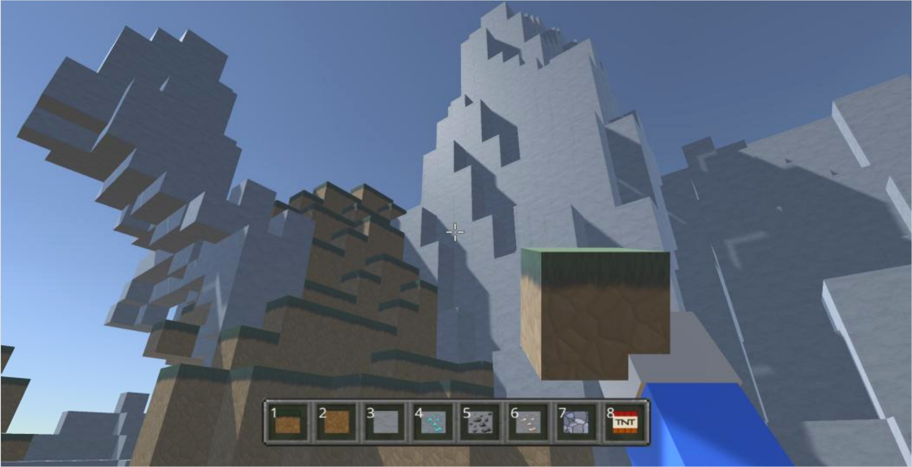
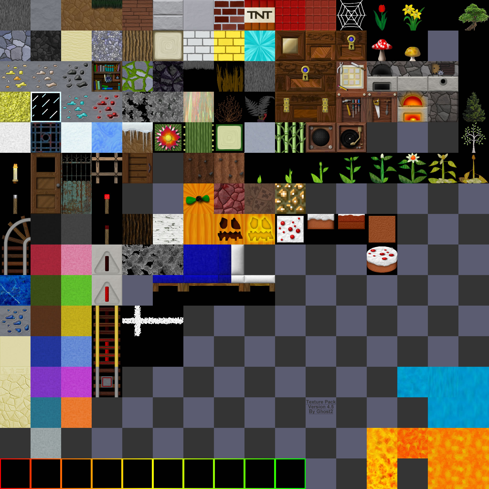
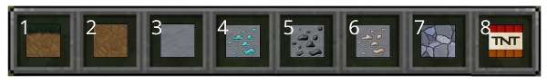
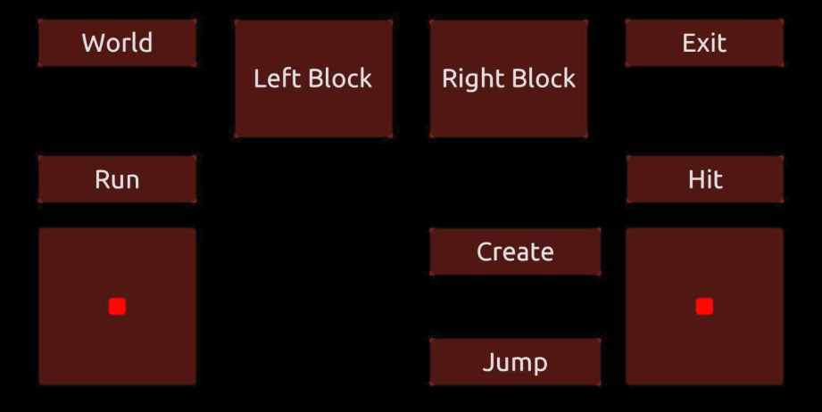

# Interação em Ambientes Virtuais - Projeto e Trabalhos Práticos

Trabalhos práticos e projeto final da unidade curricular de **Interação em Ambientes Virtuais** (IAV) de LEIM, no ISEL, ano letivo 2024/2025.

- **Fábio Pestana** — 50756
- **João Ramos** — 50730
- **Turma:** 61D
- **Docente responsável:** Diogo Cabral



---

## Descrição

A unidade curricular explora a criação de ambientes virtuais interativos em **Unity**, através de três temas: **geração procedimental**, **aprendizagem automática** (aprendizagem por reforço com ML-Agents) e **interação pessoa-máquina**. Cada tema deu origem a um trabalho prático, e o projeto final integra os três num único jogo.

| Trabalho | Tema |
|---|---|
| TP1 | Mundo voxel estilo Minecraft com geração procedimental | 
| TP2 | Agentes inteligentes com ML-Agents (aprendizagem por reforço) |
| TP3 | Interação pessoa-máquina: áudio, microfone, OSC e LLM |
| Projeto final | Mundo voxel + agentes predadores/presa + comando no telemóvel |

---

## Estrutura do repositório

```
IAV/
├── README.md
├── Imagens/                              # Imagens usadas neste README
├── TP1/
│   ├── Relatório_A50730_A50756.pdf
│   └── Scripts/
│       ├── World0.cs, PerlinTest.cs
│       └── Minecraft/                    # Block, Chunk, Utils, World, BlockInteraction, HandAndBuildBlock
├── TP2/
│   ├── Relatorio_A50730_A50756.pdf
│   └── Scripts/
│       ├── Hello World/                  # MoveToTarget
│       ├── Food Button/                  # Button, Food, FoodAgent, FoodSpawner, FoodSpawnEnv, Wall
│       ├── B-Splines/                    # TestingPathCreator
│       ├── Road/                         # ProceduralRoad, ProceduralRoad3D, RoadMesh, SimpleCarController, CarInit
│       ├── RayPerceptionSensor/          # Agent Ray Perception
│       └── ManagerScenes.cs, PersistentEventSystem.cs
├── TP3/
│   ├── Relatório_A50730_A50756.pdf
│   └── Scripts/                          # AudioAnalysis, DrawSpectrum, SoundTime, Mic, ChangeSphere,
│                                         # Receiver, TouchOSCReceiver
└── Projeto/
    ├── Relatório_A50730_A50756.pdf
    └── Scripts/
        ├── Minecraft/                    # Block, Chunk, Utils, World, BlockInteraction, HandAndBuildBlock
        ├── Agents/                       # Predator, Prey
        └── Player/                       # PlayAgent, TouchOSCReceiver
```

---

## TP1 — Mundo voxel (geração procedimental)

Criação de um ambiente do tipo Minecraft em Unity, composto por blocos (voxels) que o jogador pode destruir e colocar.



*Texture atlas (16×16 texturas) utilizado, em vez do fornecido pelos docentes.*

**Principais componentes**
- **`Block`:** tipos de bloco (Grass, Dirt, Stone, Diamond, Coal, Iron, Cobblestone, TNT e Air), texturas do *texture atlas* e desenho apenas das faces visíveis (sem vizinho sólido).
- **`Chunk`:** grupos de 16×16×16 blocos combinados numa única malha para reduzir chamadas de renderização, geração de minérios abaixo da camada de pedra, com probabilidades próprias.
- **`Utils`:** alturas do terreno com *Perlin Noise* e movimento browniano fractal (parâmetros `smooth`, `octaves`, `persistence` e `maxHeight`), e camada de pedra irregular.
- **`World`:** criação recursiva de chunks à volta do jogador e remoção dos que ficam fora do raio, com *coroutines*.
- **`BlockInteraction`:** botão esquerdo destrói e botão direito constrói, com *Raycast* e tratamento dos blocos nas bordas dos chunks vizinhos.
- **`HandAndBuildBlock`:** bloco na mão do jogador e seleção de 8 tipos de bloco na *hotbar* (teclas 1 a 8).



*Hotbar com os 8 tipos de bloco.*

---

## TP2 — Aprendizagem por reforço (ML-Agents)

Simulações em Unity com o **ML-Agents Toolkit**, treinadas com PPO e monitorizadas no TensorBoard.

- **HelloWorld:** o agente aprende a chegar a um alvo sem tocar nas paredes (observações: posições do agente e do alvo, recompensa +1 no alvo e −1 na parede).
- **FoodButton:** o agente tem de carregar num botão para fazer aparecer comida e depois chegar até ela. Foram comparados o treino convencional, o treino com **vários ambientes em paralelo**, a aprendizagem por imitação e o uso de **stacked vectors**. Comparou-se também `rb.velocity` (recompensa média 1,55) com `rb.AddForce` (1,14), e o grupo escolheu `AddForce` por ser mais realista.
- **PathCreator / ProceduralRoad3D:** estrada gerada proceduralmente com curvas de Bézier (asset PathCreator), *Perlin Noise* e malha 3D (`RoadMesh`), ajustada ao relevo do terreno, com um carro controlado por `WheelColliders`.
- **Ray Perception Sensor:** o agente deteta o ambiente com raios num arco de 140° e procura a esfera na outra sala. O sensor sozinho teve recompensa média de 1,36. Ao juntar a observação `targetRoom` desceu para cerca de −0,02, e o grupo manteve apenas o sensor.
- **ManagerScenes:** menu simples para navegar entre as cenas.

---

## TP3 — Interação pessoa-máquina

- **Audio Scene:** visualização do espectro de uma música com 1024 cubos em círculo, 7 cubos por bandas de frequência e um cubo com a energia média do sinal.
- **Microphone Scene:** classifica o som do microfone (ou de um áudio gravado). Acima de 80 dB, se mais de 70 % da energia estiver concentrada na frequência dominante é um **assobio** (o agente roda 15°). Caso contrário é **outro som** (o agente avança).
- **Scale Cube TouchOSC:** o telemóvel (aplicação TouchOSC, protocolo **OSC**) controla a escala de um cubo, por um *slider* (`/1/fader1`) ou pelo **acelerómetro** (`/accxyz`), com um botão para alternar entre os modos.
- **LLM Scene:** NPCs controlados por um modelo de linguagem local (**Ollama**, Llama 3.2 da Meta), que respondem a comandos em linguagem natural e podem abrir uma porta, recusar ou até matar o utilizador. O relatório discute vantagens (jogabilidade dinâmica, menos código) e desvantagens (alucinações, testes menos determinísticos).

---

## Projeto final

Integra os três temas numa aplicação Unity: um **mundo voxel** infinito, **agentes predadores** treinados com aprendizagem por reforço e um **comando no telemóvel** (TouchOSC) para controlar o jogador no computador.


*Letras "IAV" construídas pelo jogador com os blocos da hotbar.*

### Geração procedimental
Mundo infinito em chunks de 16×16×16 com terra, pedra e minérios. O jogador pode destruir blocos ou colocar até 8 tipos, escolhidos na hotbar.

### Aprendizagem automática
Cenário de **predadores contra uma presa**, em duas variantes: 2 predadores contra 1 presa e 3 predadores contra 1 presa. Treino com **PPO**, **self-play** e **múltiplos ambientes em paralelo**.


*Ambientes de treino em paralelo (predadores a verde, presa a vermelho).*

- **Predador:** observa a posição relativa da presa e move-se com duas ações contínuas (eixos X e Z). Penalização por passo (−1/MaxStep). Na captura, todos os predadores são recompensados pela distância à presa (+1 se estiver a menos de 6, +0,7 até 12 e −1 se mais longe), para que todos participem na caça. Penalização de −1 ao bater numa parede.
- **Presa:** observa até 3 predadores (direção e distância), é ligeiramente mais rápida, ganha +0,01 por passo sobrevivido e −1 ao ser apanhada. A penalização por bater na parede subiu para −3, porque com −1 a presa batia nas paredes para fugir.
- **Parâmetros (PPO):** taxa de aprendizagem 0,0003, *batch* de 64, *buffer* de 640, β = 0,005, ε = 0,2, λ = 0,95, 3 épocas, γ = 0,99, 200 000 passos máximos e *self-play* com janela de 5 políticas.

### Cenas
- **Cena das simulações:** o utilizador observa os agentes a treinar a partir de uma "varanda" e escolhe voltar ao mundo Minecraft ou jogar como presa.
- **Cena do utilizador contra os predadores:** o utilizador joga como presa (modo heurístico do agente) contra 2 ou 3 predadores treinados.

| | |
|---|---|
|  |  |
| *Início da cena das simulações* | *Arena com a presa e os predadores* |

### Comando no telemóvel (TouchOSC)
A classe `TouchOSCReceiver` recebe mensagens OSC na porta local **7001** e associa-as a ações do jogo. As classes de movimento e de câmara foram alteradas para deixarem de depender do teclado e do rato.



| Comando OSC | Botão na interface | Ação |
|---|---|---|
| `/move` | Joystick esquerdo | Mover a personagem |
| `/see` | Joystick direito | Orientar a câmara |
| `/button4` | Jump | Saltar |
| `/button7` | Run | Alternar entre andar e correr |
| `/button3` e `/button5` | Hit e Create | Destruir e colocar blocos |
| `/button8` e `/button9` | Left Block e Right Block | Escolher o bloco na hotbar |
| `/button10` | World | Alternar entre cenas |
| `/button6` | Exit | Fechar o jogo |

### Trabalho futuro
Integrar os agentes treinados diretamente no mundo voxel, para que atuem no mesmo mundo que o jogador.

---

## Tecnologias utilizadas

- **Unity** e **C#**
- **Perlin Noise**, *texture atlas* e combinação de malhas (*meshes*)
- **ML-Agents Toolkit** (PPO, *self-play*, treino em paralelo) com **Python** e **TensorBoard**
- Asset **PathCreator** (curvas de Bézier)
- **TouchOSC** e protocolo **OSC**
- **Ollama** (Llama 3.2) para NPCs com linguagem natural
