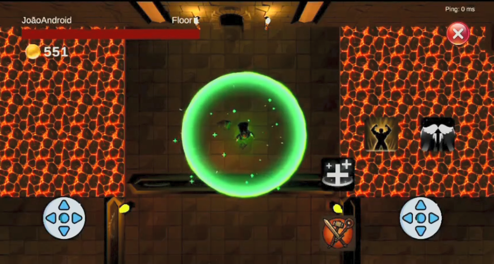
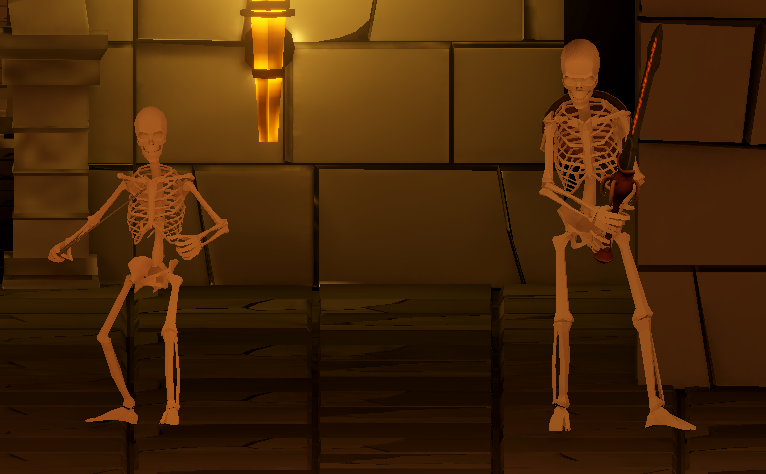
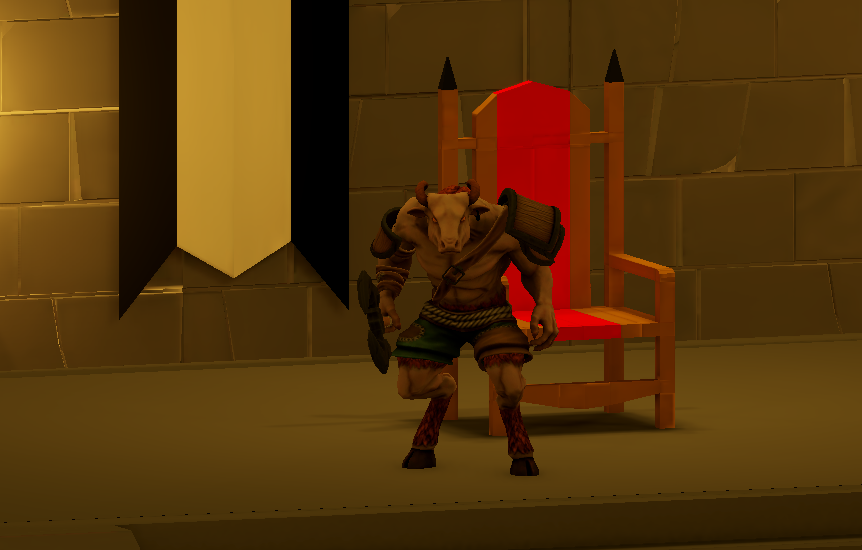
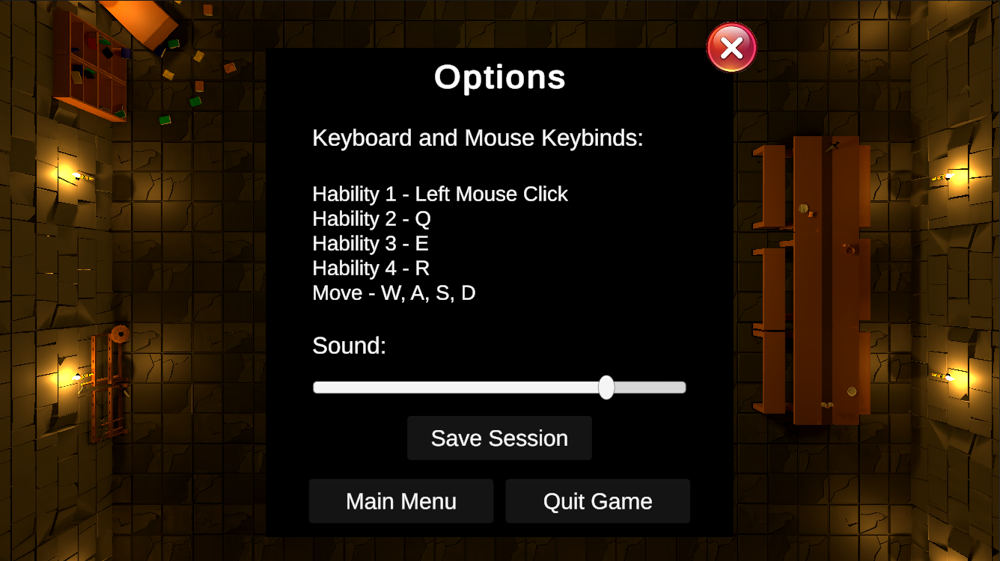

# Again — Jogo Multiplataforma Multiplayer

Projeto final da Licenciatura em Engenharia Informática e Multimédia (LEIM) do Instituto Superior de Engenharia de Lisboa (ISEL), desenvolvido na unidade curricular de **Projeto**, ano letivo 2024/2025 (proposta #50, junho de 2025).

**Alunos:**
- Fábio Pestana — 50756
- João Ramos — 50730

**Orientador:** Professor Hugo Cordeiro


---

## Descrição

**Again** é um jogo **Roguelike** multiplayer cooperativo, desenvolvido em **Unity 6**, para **Windows** e **Android**, com suporte a **crossplay**: jogadores em plataformas diferentes jogam na mesma sessão.

Até três jogadores escolhem uma de três classes (Guerreiro, Mago ou Clérigo) e enfrentam inimigos em andares de uma dungeon, com bosses nos andares 5 e 10. Quando todos morrem, regressam ao **Nexus**, uma zona de descanso onde gastam as moedas recolhidas para desbloquear habilidades e tentar de novo. O jogo também tem modo singleplayer, com o progresso guardado localmente.

O projeto foi inspirado em *Soul Knight* (ciclo de jogo), *Nuclear Throne* (personagem orientada para o cursor), *Hades* (detalhe das animações) e *Lethal Company* (lobbies e gravação de sessões).

### Funcionalidades
- **Multiplayer cross-platform** (Windows e Android) com lobbies públicos e privados e até 3 jogadores.
- **Singleplayer** com gravação e carregamento de sessões.
- **3 classes jogáveis**, cada uma com um ataque básico e três habilidades desbloqueáveis por nível.
- **Inimigos com IA** (esqueletos e um Boss minotauro com duas fases).
- **Dungeon com 10 andares** e Nexus, construída com 8 tipos de sala e 4 mapas diferentes, com perigos de ambiente (lava e serras giratórias).
- **Controlos adaptados a cada plataforma:** rato e teclado no PC, joysticks e botões virtuais no Android.
- **Sistema de progressão:** moedas ganhas a derrotar inimigos, gastas em novas habilidades.
- **Menu de opções** com controlo de volume e guardar sessão.

---

## Imagens

| | |
|---|---|
|  |  |
| *Lobby multiplayer com dois jogadores em PC e um em Android* | *Sessão no Android (Clérigo a usar a cura em área)* |
|  |  |
| *Sessão em PC com o Mago* | *Sala do jogo com áreas de lava e serras* |

### Personagens, inimigos e opções


*Classes jogáveis: Mago, Guerreiro e Clérigo.*



*Inimigos base: esqueletos (versão simples e versão com espada longa e combo).*



*Boss: Minotauro, com duas fases.*



*Menu de opções com controlos de teclado e rato, volume e guardar sessão.*

---

## Jogabilidade

### Classes

| Classe | Papel | Habilidades |
|---|---|---|
| **Guerreiro (Knight)** | Combate corpo a corpo | Ataque com espada, **bloqueio** (nível 2), **ataque giratório** em área (nível 3),**projétil** em linha reta com muito dano (nível 4) |
| **Mago (Mage)** | Dano à distância e em área | Projétil mágico, **bola de fogo** (nível 2), **meteoro de gelo** em área (nível 3), **explosão** à volta da personagem (nível 4) |
| **Clérigo (Cleric)** | Suporte | Ataque com martelo, **cura em área** (nível 2), **buff** de dano em área (nível 3), **reviver** os aliados caídos (nível 4) |

### Controlos

**PC (Windows):** a personagem está sempre virada para o cursor do rato.

| Ação | Tecla |
|---|---|
| Mover | W, A, S, D |
| Ataque básico | Botão esquerdo do rato |
| Habilidades 1, 2 e 3 | Q, E e R |

**Android:** joystick esquerdo para mover, joystick direito para apontar e botões no ecrã para o ataque e as habilidades.

### Progressão
- Cada andar exige derrotar pelo menos **8 inimigos** (ou o Boss, nos andares 5 e 10) para avançar para o próximo mapa, depois de todos os jogadores estarem prontos.
- Os inimigos ficam mais fortes (vida, dano e recompensa) com o andar e com o número de jogadores.
- Se todos os jogadores morrerem, são reanimados e voltam ao primeiro mapa (Nexus), onde gastam as moedas em novas habilidades.
- Jogadores mortos podem observar os aliados através da câmara da sala.

---

## Arquitetura

- **Rede:** *Netcode for GameObjects* com modelo de autoridade no host (cliente-servidor). Movimento e animações têm autoridade no cliente.Dano, efeitos, moedas e upgrades são validados no servidor (`ServerRpc` / `ClientRpc` e `NetworkVariable`).
- **Lobbies e conectividade:** *Unity Lobby* (criação, listagem e entrada por código ou por lista pública, *heartbeat*, estado "pronto" e classe escolhida) e *Unity Relay* (ligação entre redes sem *port forwarding*).
- **Personagens:** classe base `CharacterBase` (movimento, vida, cooldowns, morte, UI e saves), da qual herdam `Knight`, `Mage` e `Cleric`.
- **Inimigos:** classe `Skeleton` (e `Boss` como classe filha), máquinas de estados com o *Animator* (patrulha, perseguição e ataque), *NavMesh* para navegação, *Raycast* para visão e `Spawner` para gerar inimigos por sala. A IA corre apenas no servidor.
- **Progressão do jogo:** o `GameManager` controla a escolha aleatória do mapa seguinte (Dungeon 1 e 2 para andares normais, Dungeon 3 e 4 para os andares com Boss), as transições e o regresso ao Nexus.
- **Persistência:** `SaveSystem` guarda em ficheiros binários o utilizador (nome e GUID, em cada dispositivo) e as sessões (no dispositivo do host), com os dados de cada jogador: nível, moedas e classe.
- **Singleplayer:** reutiliza o código multiplayer, com um lobby privado de um só jogador, sem código de entrada visível.
- **UI:** `GameUI` (HUD, habilidades, menus), `ManagerUI` (navegação, lobbies e sessões) e `MainMenu`, adaptados a PC e Android.

---

## Estrutura do repositório

```
Projeto/
├── README.md
├── Apresentação.pdf                          # Apresentação do projeto
├── _2024-25_LEIM_proposta_PRJ_50.pdf         # Proposta de projeto
├── Imagens/                                  # Imagens usadas neste README
└── PRJ_50_50730_50756/
    ├── _README.txt                           # Nota sobre os ficheiros de grande dimensão
    ├── _RELATORIO/
    │   └── _PRJ_50_relatorio.pdf             # Relatório final
    ├── 00_Planeamento/
    │   └── Requisitos.xlsx                   # Requisitos do sistema
    ├── 01_Analise/
    │   └── _nao_aplicavel.txt
    ├── 02_Desenho/
    │   └── Game_Design_Document.pdf          # Game Design Document (GDD)
    ├── 03_Implementacao/                     # Scripts C# do jogo
    │   ├── GameManager.cs
    │   ├── Data/                             # SaveSystem, GameSessionData, PlayerSessionData, UserData
    │   ├── Enemies/                          # Skeleton, Boss, Spawner e estados da IA
    │   ├── Network/                          # LobbyManager e RelayManager
    │   ├── Player/                           # CharacterBase, Knight, Mage, Cleric e sincronização em rede
    │   ├── Sound/                            # SoundManager
    │   └── UI/                               # GameUI, ManagerUI e MainMenu
    └── 04_Teste/
        ├── ReadMeTESTES.txt
        └── Imagens/                          # Capturas dos casos de utilização testados
```

> **Nota:** os ficheiros `UnityPackage`, a *build* para Windows e o APK **não se encontram no repositório**, devido ao seu tamanho.

---

## Testes e resultados

- **Desempenho:** entre 100 e 120 FPS no PC e 60 FPS estáveis no Android.
- **Rede:** *ping* na ordem dos 50 ms em sessões online, sem atrasos visíveis na sincronização.
- **Utilizadores:** 10 pessoas responderam a um questionário de satisfação (4 testaram nas duas plataformas, 5 só no PC e 1 só no Android). Ninguém sentiu lentidão, os controlos, a interface e o combate foram considerados intuitivos. As sugestões foram mais variedade de inimigos, melhorias na interface e mais sons.
- As capturas dos casos de utilização testados (singleplayer, criar sala, configurações e juntar-se a uma sala) estão em `PRJ_50_50730_50756/04_Teste/Imagens`.

## Trabalho futuro

Novas classes, inimigos e habilidades, geração procedimental de mapas, melhorias na interface, *matchmaking* automático, NPCs e sistema de conquistas.

---

## Tecnologias utilizadas

- **Unity 6** e **C#**
- **Netcode for GameObjects**, **Unity Lobby** e **Unity Relay**
- **AI Navigation (NavMesh)**, **Visual Effect Graph** e *Particle Systems*
- Modelos e cenários da **Unity Asset Store** (estilo *low poly*) e animações do **Mixamo**
